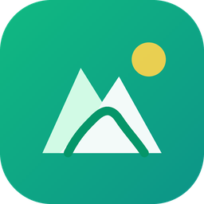
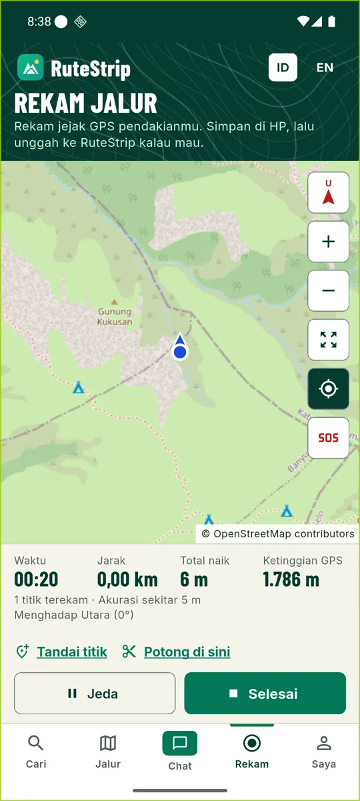
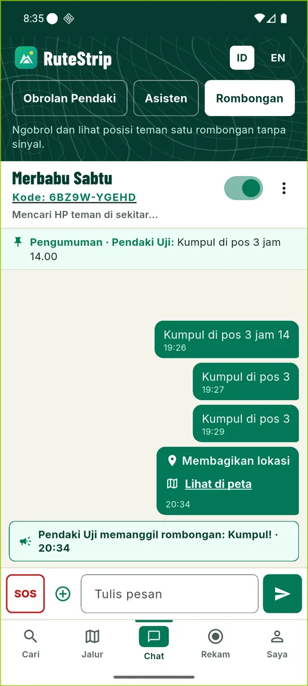
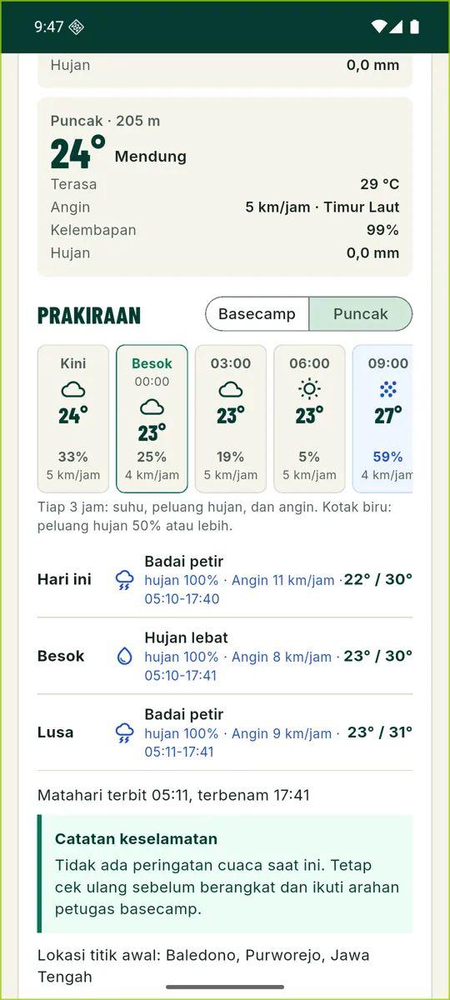
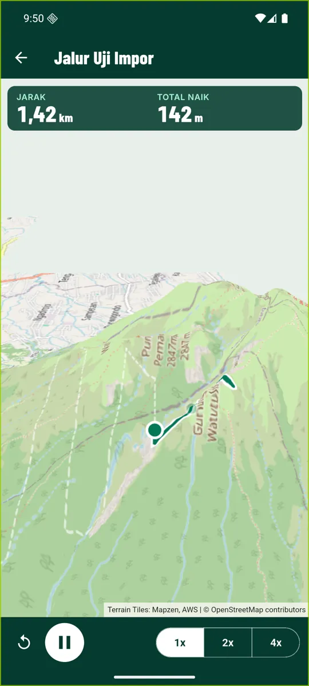
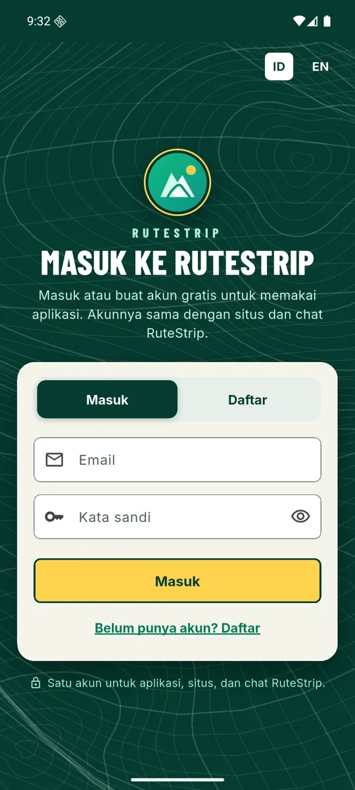
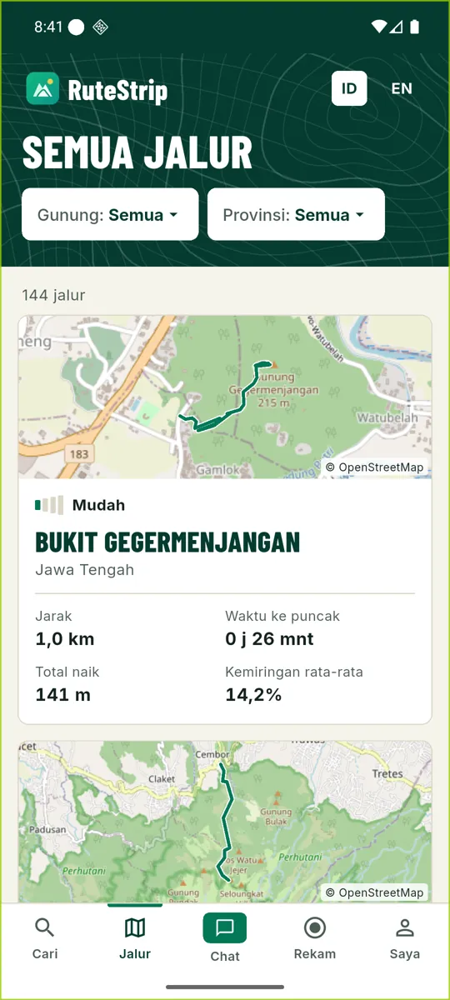
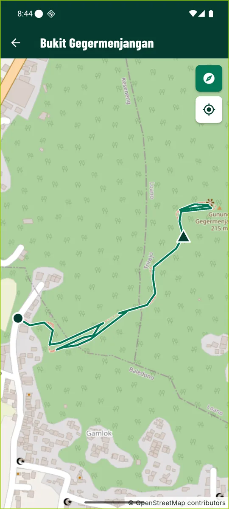
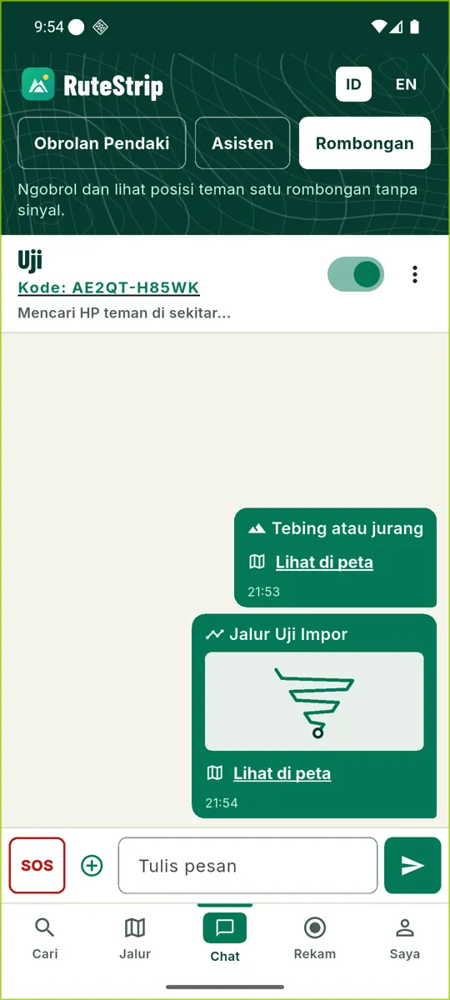
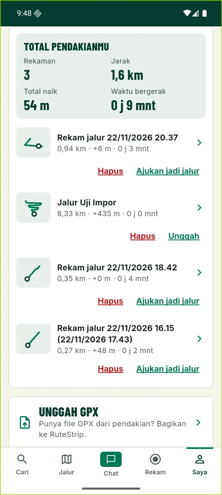

<div align="center">



# RuteStrip untuk Android

**Cari jalur dengan kalimat biasa. Rekam pendakianmu. Tetap terhubung dengan rombongan saat sinyal hilang.**

[](https://flutter.dev)
[](https://dart.dev)
[](https://rutestrip.ai.id/install)
[](https://rutestrip.ai.id)
[](https://www.openstreetmap.org/copyright)

[**Unduh APK**](https://rutestrip.ai.id/install) · [Situs aplikasi](https://app.rutestrip.ai.id) · [RuteStrip web](https://rutestrip.ai.id) · [HP 32-bit](https://rutestrip.ai.id/install/lama)

</div>

<p align="center">
  
  
  
  
</p>

---

## Isi aplikasi

### Sebelum berangkat
- **Cari jalur dengan kalimat biasa.** Tulis "jalur landai untuk pemula dekat Malang" dan dapat jalur di Pulau Jawa yang paling cocok, dengan peringkat yang sama seperti di situs.
- **Halaman jalur lengkap.** Peta, profil ketinggian, waktu jalan (Naismith), tingkat kesulitan, ulasan pendaki, dan jalur yang mirip.
- **Cuaca di basecamp dan puncak.** Kondisi sekarang, prakiraan tiap 3 jam untuk 48 jam ke depan, dan ringkasan 3 hari. Kotak biru menandai peluang hujan 50% atau lebih.
- **Simpan offline.** Jalur yang disimpan tetap bisa dibuka dan diikuti tanpa sinyal.

### Di jalur
- **Rekam jalur.** GPS tetap merekam saat layar mati, dengan notifikasi. Peta mengikuti posisimu, kompas, putar peta sesuai arah HP, zoom, dan peta topografi bergaris kontur.
- **Ikuti jalur.** Sisa jarak, perkiraan waktu sampai ujung, waktu ke pos atau puncak berikutnya, dan peringatan saat keluar jalur.
- **Tandai titik.** Pos, sumber air, camp, puncak, persimpangan, tebing, sinyal HP, dan bagian berbahaya.
- **Potong di sini.** Simpan hari pertama, lanjut merekam hari kedua.
- **Foto + info.** Foto dengan ketinggian, koordinat, waktu, dan jarak yang sudah ditempuh tercetak di bawahnya.
- **Bagikan lokasi online.** Saat ada sinyal, posisimu terkirim ke tautan rahasia yang bisa dibuka keluarga atau petugas basecamp. Tautan berakhir sendiri.

### Saat sinyal hilang: Rombongan
HP satu rombongan saling terhubung lewat Bluetooth dan Wi-Fi, tanpa internet. Pesan diteruskan dari HP ke HP, jadi yang di depan tetap menerima pesan dari yang di belakang selama ada HP di antaranya.

- Chat, posisi teman di peta dengan warna masing-masing, arah jalan, dan baterai.
- **SOS** dengan sirene, panggil rombongan ("Kumpul!"), dan pengumuman yang disematkan.
- Kirim lokasi, tandai titik (air, tebing, bahaya), dan kirim jejak rekaman.
- Gabung lewat kode atau **QR**. Isi pesan dikunci AES-256-GCM dengan kunci dari kode rombongan dan ditandatangani Ed25519 per HP. Detail di [`docs/MESH.md`](docs/MESH.md).

### Setelah turun
- **Putar ulang 3D.** Kamera terbang mengikuti jejakmu di atas medan 3D, lengkap dengan jarak, total naik, dan titik yang ditandai.
- **Ajukan jadi jalur.** Rekaman diproses server lalu masuk rekomendasi setelah disetujui admin. Statusnya ada di "Kiriman jalurku".
- **Total pendakian**, GPX untuk dibagikan, dan unggah file GPX.

### Selalu ada
Obrolan Pendaki, Asisten RuteStrip (AI), satu akun untuk aplikasi, situs, dan chat, serta tampilan Bahasa Indonesia dan Inggris.

<p align="center">
  
  
  
  
  
</p>

---

## Tech stack

| Bagian | Yang dipakai |
| --- | --- |
| Aplikasi | Flutter 3.50 (Dart 3), Material, tanpa state library tambahan (`ChangeNotifier` + `InheritedNotifier`) |
| Peta | `flutter_map` dengan ubin OpenStreetMap dan OpenTopoMap, `latlong2` |
| Medan 3D | MapLibre GL JS 5 (disertakan di aplikasi) dalam `webview_flutter`, ubin elevasi Terrarium (AWS Open Data) |
| Lokasi dan sensor | `geolocator` (satu aliran GPS untuk seluruh aplikasi, foreground service), `flutter_compass`, `battery_plus` |
| Rombongan offline | `nearby_connections` (Google Nearby, P2P_CLUSTER), `cryptography` (AES-256-GCM, Ed25519, PBKDF2), `qr_flutter`, `mobile_scanner` |
| Notifikasi dan suara | `flutter_local_notifications`, `audioplayers` (sirene SOS sebagai suara alarm) |
| Penyimpanan | `flutter_secure_storage` (token, kode rombongan), `shared_preferences`, file JSON/GPX lokal |
| Kamera dan berbagi | `image_picker`, `gal`, `share_plus`, `file_picker` |
| Backend | Laravel (PHP 8.4) JSON API `/api/v1`, SSO bersama situs dan chat, SBERT untuk pencarian, Open-Meteo untuk cuaca |

## Arsitektur singkat

```
lib/
  main.dart, app_state.dart     akun, bahasa, satu AppScope untuk seluruh layar
  api.dart                      semua panggilan ke rutestrip.ai.id/api/v1
  location_hub.dart             satu aliran GPS dengan kebutuhan terkuat (rekam, rombongan, berbagi, pratinjau)
  live_share.dart               tautan lokasi online
  mesh/                         protokol, node relay, transport Nearby, layanan rombongan
  notify.dart                   notifikasi rombongan, SOS, dan sirene
  recording_math.dart           jarak, kemajuan di jalur, tanjakan, waktu Naismith
  screens/, widgets/            layar dan komponen
assets/replay/                  halaman MapLibre untuk putar ulang 3D
```

## Membangun

```powershell
flutter pub get
flutter analyze
flutter test
flutter build apk --release --split-per-abi --obfuscate --split-debug-info=build/symbols
```

APK per jenis CPU ada di `build\app\outputs\flutter-apk\`. Untuk menguji dengan backend lokal, build debug boleh memakai HTTP biasa ke 127.0.0.1 saja:

```powershell
adb reverse tcp:8000 tcp:8000
```

```powershell
flutter run --dart-define=RUTESTRIP_API=http://127.0.0.1:8000
```

## Keamanan dan privasi

- Token akun dan kode rombongan disimpan di penyimpanan terenkripsi Android, bukan di preferensi biasa.
- Rilis tidak mengizinkan HTTP tanpa enkripsi; hanya build debug yang boleh ke 127.0.0.1.
- Pesan rombongan tidak lewat server mana pun. Paket yang lebih tua dari 24 jam, lebih besar dari 8 KB, atau tanda tangannya salah dibuang dan tidak diteruskan.
- Tautan lokasi online hanya menyimpan posisi terakhir, tidak diindeks mesin pencari, dan berakhir sendiri.
- Halaman 3D hanya memuat file lokal di aplikasi; navigasi ke alamat lain diblokir.

## Desain

Ikut panduan desain situs RuteStrip: pita hijau zamrud gelap dengan motif garis kontur, latar kertas peta, hijau zamrud untuk tautan dan tombol kedua, kuning fajar hanya untuk satu aksi utama di tiap layar. Judul memakai Barlow Condensed dan isi memakai Inter (keduanya SIL OFL, lisensi di `assets/fonts`).

## Sumber data dan kredit

- Peta © [kontributor OpenStreetMap](https://www.openstreetmap.org/copyright) (ODbL). Peta topografi © [OpenTopoMap](https://opentopomap.org) (CC-BY-SA), elevasi SRTM.
- Medan 3D: Terrain Tiles dari Mapzen di AWS Open Data. MapLibre GL JS berlisensi BSD-3-Clause (`assets/replay/maplibre-gl-LICENSE.txt`).
- Cuaca dan elevasi DEM: [Open-Meteo](https://open-meteo.com). Lokasi: OpenStreetMap Nominatim.
- Data jalur untuk perencanaan, bukan alat navigasi. Selalu cek status jalur dan izin ke pengelola setempat.

---

<p align="center">© 2026 Aeternum Kreasikan Bersama · RuteStrip</p>
